<p align="center">
  <a href="https://orbitwake.com" title="See what I'm building">
    
  </a>
</p>

<p align="center">
  <a href="https://orbitwake.com">Current build</a> &nbsp;·&nbsp;
  <a href="https://developers.orbitwake.com">Developer docs</a> &nbsp;·&nbsp;
  <a href="https://github.com/idrivehtbusiness?tab=repositories">Repositories</a>
</p>

## Hey, I'm Jules.

Developer, systems and network engineer, and product builder.

I turn complicated problems into software people can actually use. Sometimes that means a good interface. Sometimes it means a network that stays online. Sometimes it means explaining why the DNS change needs another five minutes.

> If someone says “it should be a quick fix,” I quietly open the architecture diagram.

### What keeps me busy

| Software & data | Cloud & networks | Automation & operations |
| :--- | :--- | :--- |
| Full-stack products, APIs, AI integrations, data platforms, mapping tools | AWS, Linux, networking, Cloudflare, deployment, reliability, security | GitHub Actions, CI/CD, Salesforce, Zoho, internal workflows, business integrations |

**Tools I reach for:** `TypeScript` `JavaScript` `Python` `React` `Next.js` `Node.js` `SQL` `PostgreSQL` `AWS` `Linux` `GitHub Actions`

### Things I'm building

- **[OrbitWake](https://orbitwake.com)** — an AI-native workspace for code, cloud and developer workflows.
- **[La Grâce Solutions](https://lagracesolutions.com)** — a customer-facing retail platform and digital shopping experience.
- **Behind the scenes** — education platforms, operational systems, geospatial tools, data pipelines and automation. Not everything useful lives in a public repository.

### Notes from the terminal

```text
$ git status
On branch one-more-feature
Your branch is ahead of 'origin/realistic-schedule' by 37 ideas.

$ systemctl status curiosity
active (running)

$ dig +short patience.example
;; still propagating
```

I like clean architecture, useful automation, tested backups, and interfaces that don't make people read a manual.

I also enjoy fishing. It's one of the few times when “nothing is happening” is actually good news.

<details>
<summary><b>Open the extremely confidential incident report</b></summary>

<br />

```text
INCIDENT #0001
Severity:    Dramatic
Root cause:  "Just one more feature."
Mitigation:  Coffee, tests, rollback plan.
Status:      Lessons learned. Probably.
```

The [official incident soundtrack](https://www.youtube.com/watch?v=dQw4w9WgXcQ) is available for research purposes.

</details>

---

<p align="center">
  Build useful things. Keep learning. Ship carefully.<br />
  <sub>The banner is clickable. The rollback plan is not optional.</sub>
</p>
